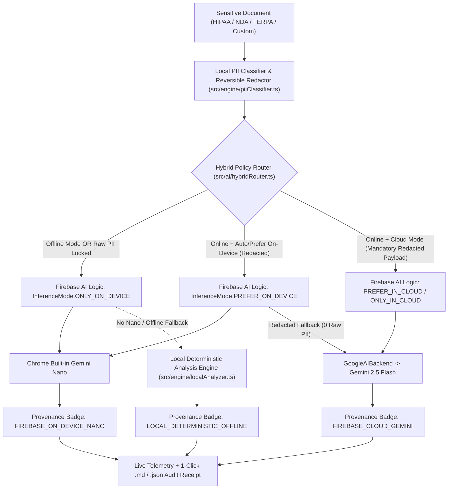

# LocalShield Hybrid — Privacy-First Clinical & Legal Hybrid AI Assistant

[](./LICENSE)
[](https://firebase.google.com/docs/ai-logic)
[](#testing)

**Live Demo:** https://trongtinh9911.github.io/localshield-hybrid-ai/  
**Built for:** Google **#BuildHybridAI 2026** Hackathon (Web / Chrome Track)

LocalShield Hybrid is a privacy-first browser application for reviewing sensitive clinical discharge summaries (HIPAA), enterprise legal NDAs, and student financial aid appeals (FERPA). It combines deterministic local PII redaction with the real **Firebase AI Logic SDK** (`firebase/ai` v12.19.0) so raw personally identifiable information stays strictly inside browser memory while still supporting hybrid on-device + redacted cloud Gemini inference.

## Architecture



## Real Firebase AI Logic SDK Integration

`src/ai/hybridRouter.ts` directly imports and executes the Firebase JS SDK v12.19.0 Hybrid Inference APIs (`firebase/app` + `firebase/ai`):

```ts
import { initializeApp } from 'firebase/app';
import {
  getAI,
  getGenerativeModel,
  GoogleAIBackend,
  InferenceMode,
  InferenceSource,
  type HybridParams,
} from 'firebase/ai';

const app = initializeApp(byokConfig, 'localshield-hybrid-runtime');
const ai = getAI(app, { backend: new GoogleAIBackend() });

const hybridParams: HybridParams = {
  mode: decision.sdkInferenceMode, // InferenceMode.ONLY_ON_DEVICE | PREFER_ON_DEVICE | PREFER_IN_CLOUD | ONLY_IN_CLOUD
  onDeviceParams: {
    createOptions: { temperature: 0.2, topK: 3 },
  },
  inCloudParams: {
    model: 'gemini-2.5-flash',
    generationConfig: { temperature: 0.2, maxOutputTokens: 1200 },
  },
};

const model = getGenerativeModel(ai, hybridParams);
const result = await model.generateContent(redactedPrompt);
// result.response.inferenceSource === InferenceSource.ON_DEVICE | InferenceSource.IN_CLOUD
```

## Core Capabilities

1. **Zero-Egress PII Boundary (`src/engine/piiClassifier.ts`):**
   - Scans SSNs, Luhn-validated payment cards, Patient MRNs / Student & FAFSA IDs, Dates of Birth, Emails, Phone Numbers, Bank IBAN / Routing numbers, Household AGI / Salaries, API keys (`AIza...`, `sk-...`, `ghp_...`, `AKIA...`), and privileged legal markers.
   - Replaces direct PII locally with deterministic, reversible placeholders (`[REDACTED_SSN_1]`, `[REDACTED_PATIENT_MRN_1]`, etc.) and scores risk (`LOW`, `MODERATE`, `HIGH`, `CRITICAL`).
   - Enforces a runtime invariant verifying `rawPiiSentToCloud === 0` across all 5 routing modes.
2. **Honest Runtime Provenance & Offline Resilience:**
   - Displays one of three explicit badges on every run: `FIREBASE_ON_DEVICE_NANO`, `FIREBASE_CLOUD_GEMINI`, or `LOCAL_DETERMINISTIC_OFFLINE`.
   - Includes a one-click **Offline Simulator (Airplane Mode)** toggle that forces `InferenceMode.ONLY_ON_DEVICE` and runs zero network requests.
   - Ships with a RAM-only **Firebase BYOK Config Modal** (never touches `localStorage` or `sessionStorage`) so judges can test live Gemini Cloud fallback with their own Firebase project if desired.
3. **Deterministic Local Clinical & Legal Analyzer (`src/engine/localAnalyzer.ts`):**
   - Works instantaneously in any browser, even completely offline without Gemini Nano downloaded: extracts binding obligations, unlimited liability / perpetual confidentiality / auto-renewal / indemnification clauses, medication allergy alerts, ER return precautions, and prioritized action items.
4. **Live Telemetry & Exportable Audit Receipts (`src/engine/telemetry.ts`, `src/engine/auditExport.ts`):**
   - Tracks latency (ms), PII tokens kept local, raw PII leaked (`0`), estimated cloud token cost saved, and On-Device vs. Cloud split percentage.
   - Exports sanitized `.md` and `.json` audit receipts in one click.

## Quick Start

```bash
npm install
npm run dev
```

## Testing

```bash
npm test
npm run build
```

All **27 Vitest unit tests** verify PII detection & Luhn validation, reversible redaction, zero-raw-PII cloud invariants across all 5 modes, Firebase AI Logic SDK `InferenceMode` / `HybridParams` mapping, offline override behavior, local analyzer extraction, telemetry math, and audit receipt exports.

## License

MIT — see [LICENSE](./LICENSE).
